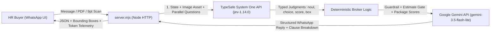

# Instasurrance SME Health AI — Product, UX & Prototype Plan

> **Naked MVP Note:** Instasurrance is a standalone, unaffiliated WhatsApp-style AI SME Health Insurance Broker prototype. It adopts only the extracted health-platform color palette (`#0088EB`, `#149ADE`, `#E0F1FD`, `#1DB97D`, `#121733`) with zero corporate affiliation.

---

## 1. Context Synthesis from the Two Wispr Flow Meetings

### Meeting 1: Briefing & Pilot Strategy (`Oct 15, 2026, 1:41 PM – 2:07 PM GMT+4`)
- **Participants:** Ibrahim Itani, Jean-Daniel BUSSY, Peter Milan Trapp
- **Transcript:** [2026-10-15_meeting-1_ibrahim-jd-peter_briefing.md](../transcripts/2026-10-15_meeting-1_ibrahim-jd-peter_briefing.md)
- **Core Business Problem:**
  - Large insurance aggregation organizations take **6+ months** to ship internal AI quotation visualization tools due to organizational overhead.
  - The goal is a **fast, plug-and-play pilot ($20k in 2 weeks)** that requires **near-zero internal engineering effort** to embed and hands off cleanly to existing checkout workflows.
- **Selected Pilot Use Case — KSA SME Health Insurance Onboarding:**
  - Unlike custom corporate policies (which trigger a **3-day manual underwriter SLA** and cause high customer drop-off), SME Health uses **predetermined insurer packages** (up to 999 employees).
  - Matching happens **on the spot** with a live match percentage (e.g., `94% Match`) and zero hallucinations, while keeping the 3 package suggestions hidden until the first estimate is completed.
- **What We Optimize For — Conversion & Eliminating HR Fear of Blame:**
  - HR buyers do not mind uploading an Excel census sheet; they drop off to offline human brokers because **corporate quotes are hard to read**, they want to **ask questions / customize benefits**, and most importantly **they hire offline brokers to take the blame** if a benefit (like optical coverage) is missing (*"I don't want to say I clicked a button and now nobody is insured for opticals"*).

### Meeting 2: Prototype Scoping (`Oct 15, 2026, 2:15 PM – 2:32 PM GMT+4`)
- **Participants:** Peter Milan Trapp, Jean-Daniel BUSSY
- **Transcript:** [2026-10-15_meeting-2_peter-jd_prototype-scoping.md](../transcripts/2026-10-15_meeting-2_peter-jd_prototype-scoping.md)
- **Key Product & UX Decisions:**
  1. **WhatsApp-Style Experience:**
     - **Zero-Friction Intake:** Phone & contact name are already known from the WhatsApp thread; the user only provides their work email and drops their old policy PDF/scan or employee census.
     - **Gated Sidebar Package Suggestions:** The 3 predetermined package suggestions on the left sidebar stay locked (`Awaiting First Estimate`) until the user triggers their first estimate or contract upload in the chat.
  2. **Disclosed AI + Human Oversight ("Blame Shield"):**
     - Transparent AI assistant overseen by a named senior account manager (*Tariq Al-Mansour, License #IA-8842*), who co-signs an **HR Coverage Benchmark Certificate** for internal management sign-off.
  3. **9pt Contract Simplifier (Bounded Boxes):**
     - Visualizes tiny-print clauses directly in the chat and on scanned contract images using color-coded bounded boxes:
       - 🟢 **Above Standard:** e.g., **60 days** to submit reimbursement claims (vs. 30-day market minimum) or **SAR 2,000 Optical** included.
       - 🔵 **Market Standard:** e.g., **PDPL & GDPR Data Privacy** protection or **10%–20% Outpatient Copay**.
       - 🔴 **Below Standard / Coverage Gap:** e.g., **12 Physiotherapy sessions** vs. 20 in the prior policy, or **SAR 500 Optical** on the basic saver tier.
  4. **Guardrails Demo:**
     - Polite de-escalation on hostility (*"Shut up"*).
     - Strict refusal to invent unauthorized discounts on regulated predetermined rates.
     - Instant warning when requesting `0% copay` (3-day manual underwriting SLA vs. instant issue on predetermined 10%–20% copay packages).
  5. **Live Token & Cost Telemetry Bar:**
     - Top fixed banner displaying live TypeSafe System One (`jev-1.14.0`) + Gemini input/output token counts, session cost, and estimated cost per completed policy (`~$0.85`).

---

## 2. Color Palette (Extracted Only — Zero Company Affiliation)

| Token | Hex | Usage |
| :--- | :--- | :--- |
| **Primary Brand Blue** | `#0088EB` | Top bar, outgoing user chat bubbles, primary CTAs |
| **Secondary Cyan Blue** | `#149ADE` | Accents, links, and "Market Standard" bounded-box highlights |
| **Soft Ice Blue Surface** | `#E0F1FD` | Active chat item, subtle card backgrounds, pills |
| **Action / Match Emerald** | `#1DB97D` | Match % badge (`94% Match`), WhatsApp online status, "Above Standard" bounded boxes |
| **Deep Navy Ink** | `#121733` | Primary typography & telemetry bar |
| **Danger / Gap Coral** | `#EF4444` | "Below Standard / Coverage Gap" bounded boxes |

---

## 3. System Architecture

- **[index.html](../index.html)**: Standalone WhatsApp Web-inspired AI chat interface with gated package matcher, live 9pt contract scan bounding-box overlay, HR Blame-Shield Certificate modal, and real-time token cost telemetry bar.
- **[server.mjs](../server.mjs)**: Zero-dependency Node.js HTTP server (`http://localhost:3030`) orchestrating **TypeSafe System One (`jev-1.14.0`)** for deterministic decisions and visual bounding boxes (`TypeSafe-Danger-Zone-Images: true`) alongside **Google Gemini (`gemini-3.5-flash-lite`)** for natural language responses.
